# k6-lab

## Part 0
- Step 0.1, http_req_duration: 265.4ms

- Step 0.2, requests, rate and p(95), and why the rate stays below 5:

    * Total requests: 74
    * Req/s: 3.634899/s
    * p(95): 362.45ms
    * Why the rate stays below 5: In each cycle (iteration) one user (VU) does not send a request and ends immediately. But there is a network round-trip wait time and server processing time (average avg = 323.7ms) combined with a full second of `sleep(1)` pause time, resulting in an average time per cycle (`iteration_duration`) of approximately 1.37 seconds. Therefore, 1 VU requests will average only about 0.73 req/s (1 / 1.37s) when running 5 VUs simultaneously. Theoretical total firing rate ($5 \times 0.73$), so it's about 3.63 req/s, which can never reach 5 req/s.

- Step 0.3, :
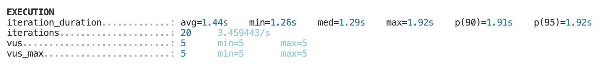 

- Step 0.4, :
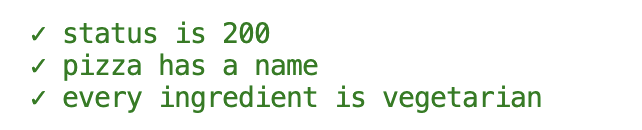

- Step 0.5, :

- Step 0.6, exit code of the normal run and of the run with P95=300:
    * exit code of the normal run: 0
    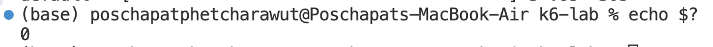
    * run with P95=300: 99
    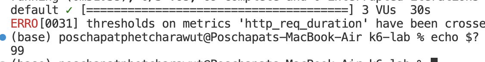

- Step 0.7, rules that passed, p(95), p(99), exit code after your change:
    * rules that passed: 
    
    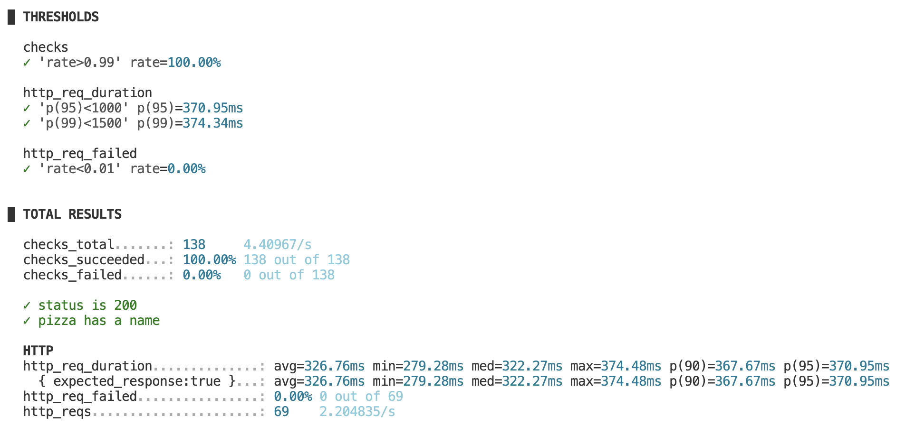
    * exit code after change: 99
    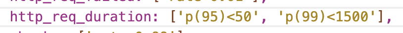
    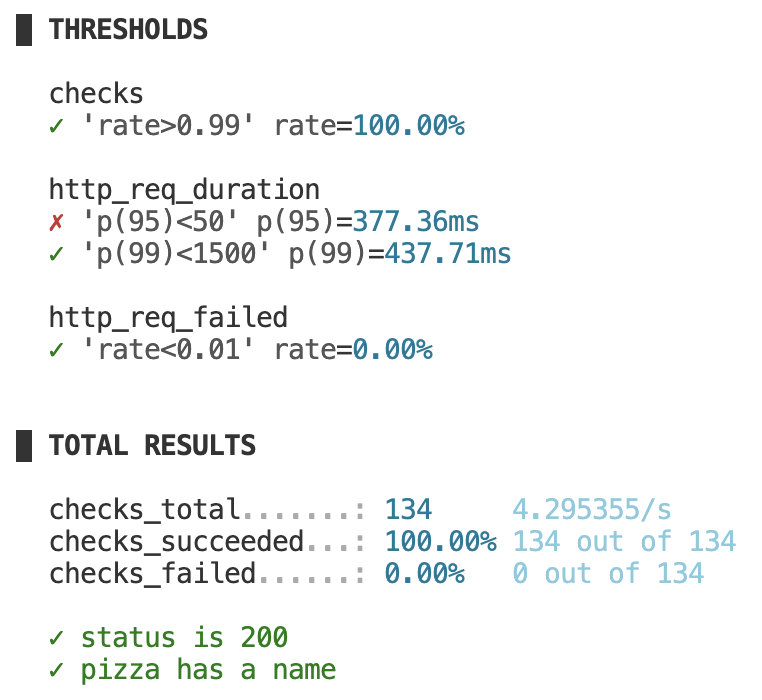
    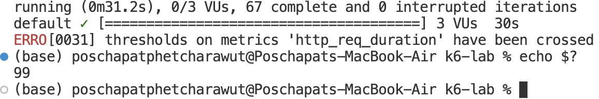

- Step 0.8, what was wrong, and how the checks showed it:
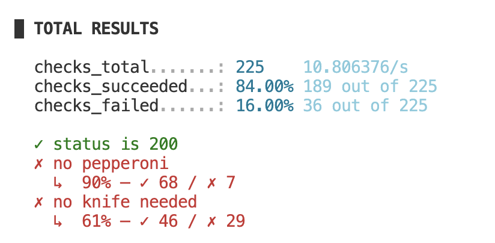

    * what was wrong:
    The exclusion names are case-sensitive; I sent lowercase pepperoni/knife but the API uses Pepperoni/Knife, so the filters were ignored. Checks under load found it because the recommendation is random: a single manual request may happen to return a pizza without pepperoni and not needing a knife, but over many requests the wrong pizzas appear with a visible failure rate.
    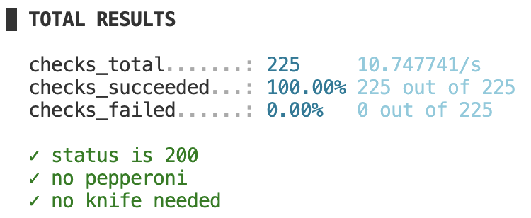

## Part A results
- Step A1:
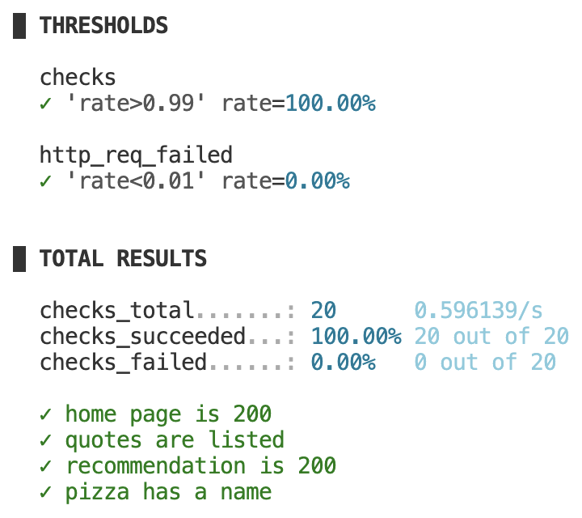

| Step | Test type | Users | Req/s | p(95) | Max | Failed | Checks |
| :--- | :--- | :---: | :---: | :---: | :---: | :---: | :---: |
| A1 | Smoke | 1 | 0.447104/s | 382.36ms | 386.79ms | 0.00% | 100% |
| A2 | Average load | 3 | 1.31647/s | 374.23ms | 445.2ms | 0.00% | 100% |
| A3 | Stress | 5 | 2.11868/s | 366.74ms | 383.8ms | 0.00% | 100% |
| A4 | Spike | 5 | 1.026088/s | 368.02ms | 431.92ms | 0.00% | 100% |
| A5 | Soak | 2 | (x) | (x) | (x) | 0.00% | 100% |
