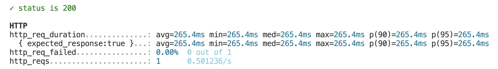
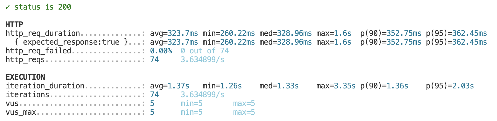
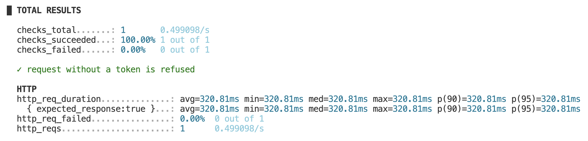

# k6-lab

## Part 0
- Step 0.1, http_req_duration: 265.4ms

- Step 0.2, requests, rate and p(95), and why the rate stays below 5:

    * Total requests: 74
    * Req/s: 3.634899/s
    * p(95): 362.45ms
    * Why the rate stays below 5: In each cycle (iteration) one user (VU) does not send a request and ends immediately. But there is a network round-trip wait time and server processing time (average avg = 323.7ms) combined with a full second of `sleep(1)` pause time, resulting in an average time per cycle (`iteration_duration`) of approximately 1.37 seconds. Therefore, 1 VU requests will average only about 0.73 req/s (1 / 1.37s) when running 5 VUs simultaneously. Theoretical total firing rate ($5 \times 0.73$), so it's about 3.63 req/s, which can never reach 5 req/s.

- Step 0.3, :
 

- Step 0.4, :

- Step 0.5, :

