# K6 lab results

## Part 0
- Step 0.1, http_req_duration: 265.4ms
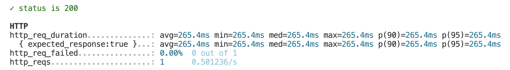

- Step 0.2, requests, rate and p(95), and why the rate stays below 5:
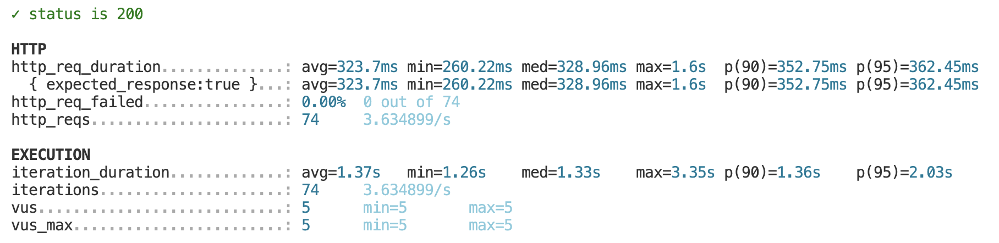
    * Total requests: 74
    * Req/s: 3.634899/s
    * p(95): 362.45ms
    * Why the rate stays below 5: In each cycle (iteration) one user (VU) does not send a request and ends immediately. But there is a network round-trip wait time and server processing time (average avg = 323.7ms) combined with a full second of `sleep(1)` pause time, resulting in an average time per cycle (`iteration_duration`) of approximately 1.37 seconds. Therefore, 1 VU requests will average only about 0.73 req/s (1 / 1.37s) when running 5 VUs simultaneously. Theoretical total firing rate ($5 \times 0.73$), so it's about 3.63 req/s, which can never reach 5 req/s.

- Step 0.3, :
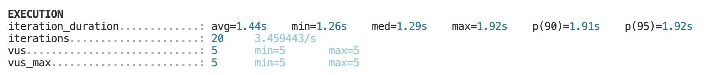 

- Step 0.4, :
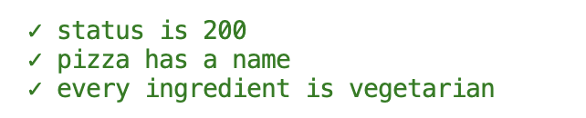

- Step 0.5, :
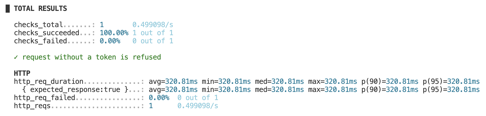

- Step 0.6, exit code of the normal run and of the run with P95=300:
    * exit code of the normal run: 0
    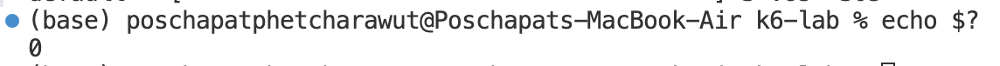
    * run with P95=300: 99
    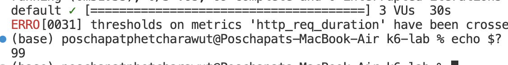

- Step 0.7, rules that passed, p(95), p(99), exit code after your change:
    * rules that passed: 
    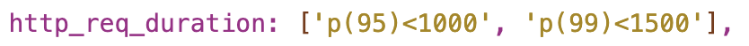
    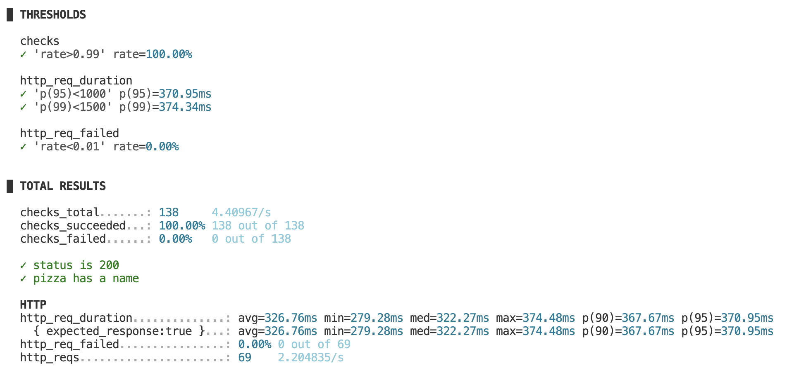
    * exit code after change: 99
    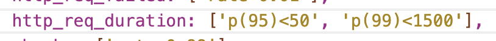
    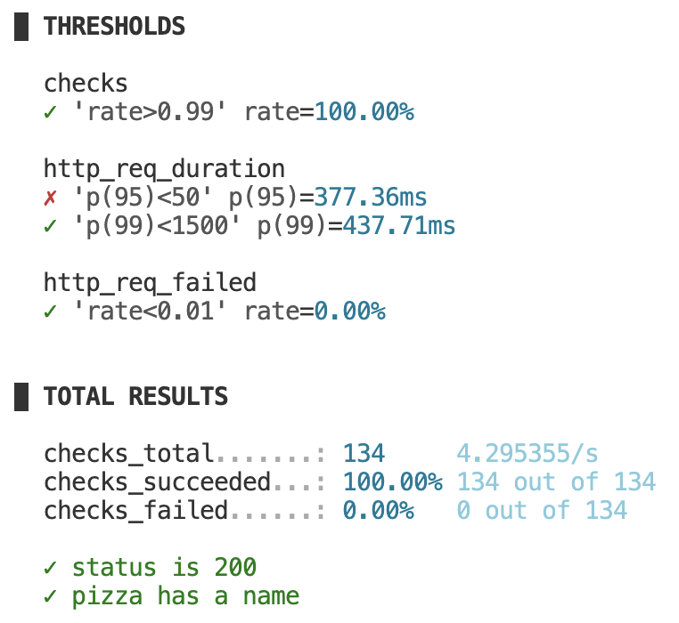
    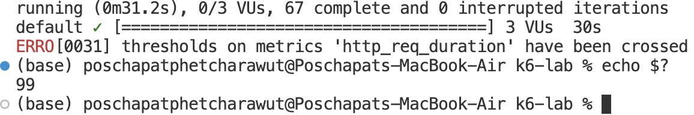

- Step 0.8, what was wrong, and how the checks showed it:
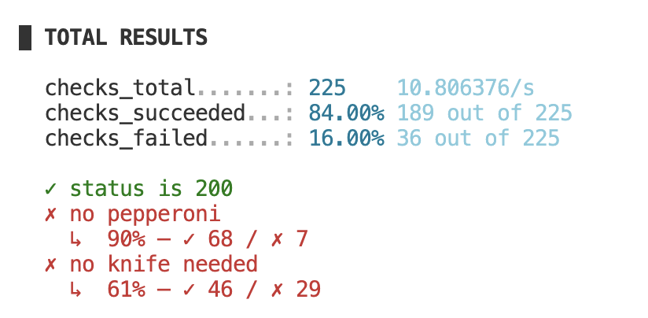

    * what was wrong:
    The exclusion names are case-sensitive; I sent lowercase pepperoni/knife but the API uses Pepperoni/Knife, so the filters were ignored. Checks under load found it because the recommendation is random: a single manual request may happen to return a pizza without pepperoni and not needing a knife, but over many requests the wrong pizzas appear with a visible failure rate.
    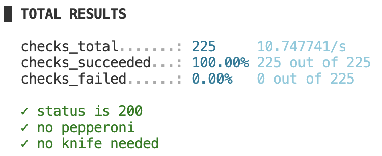

## Part A results
- Step A1:
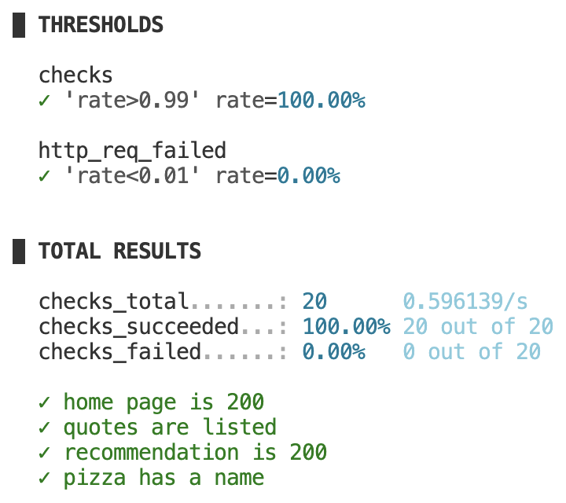

| Step | Test type | Users | Req/s | p(95) | Max | Failed | Checks |
| :--- | :--- | :---: | :---: | :---: | :---: | :---: | :---: |
| A1 | Smoke | 1 | 0.447104/s | 382.36ms | 386.79ms | 0.00% | 100% |
| A2 | Average load | 3 | 1.31647/s | 374.23ms | 445.2ms | 0.00% | 100% |
| A3 | Stress | 5 | 2.11868/s | 366.74ms | 383.8ms | 0.00% | 100% |
| A4 | Spike | 5 | 1.026088/s | 368.02ms | 431.92ms | 0.00% | 100% |
| A5 | Soak | 2 | 0.975696/s | 370.2ms | 1.01s | 0.00% | 100% |

## Part B
1. Complete the table in Part A results above.

2. Each iteration includes a 1 s sleep plus the request time (~1.37 s total), so each VU sends under 1 request/s. With 5 VUs the rate is ≈ 3.7 req/s, below 5.

3. The response time may show only a slight increase—or no significant difference—because 5 VUs (Virtual Users) remain well within the "Operational Envelope" (the server's normal capacity) of the QuickPizza server, which is capable of handling a much larger user base. Consequently, the system is nowhere near the threshold where resource bottlenecks would occur.

4. In the graph shown in `reports/a4-spike.html`, when the number of users spikes to 5, the response time surges temporarily. It then returns to normal levels within approximately 5–10 seconds after the number of virtual users (VUs) drops back to 1.

5. Response time and failure rate remain stable—showing no degradation—over a 10-minute duration. Soak tests, when run over several hours, can uncover issues such as **memory leaks** or **database connection leaks**, where resource accumulation eventually exhausts system capacity and leads to a total system crash.

6. The average can be skewed and masked by the majority of requests that respond quickly, failing to reveal issues experienced by users who encounter unusually slow performance. Using p(95) ensures that 95% of all users are receiving service faster than a specific threshold.

7.  - Internet routing jitter and network latency fluctuate due to the nature of public internet connections.
    - Shared Server Load: The QuickPizza server is accessed by users worldwide simultaneously, unlike a controlled, dedicated test machine in a lab environment.

8. This constitutes a Denial of Service (DoS) attack, which can cause server crashes, service disruptions, and increased cloud costs. Furthermore, such actions are illegal without explicit written authorization.

9. [Performance Requirement for TikTok]:
   - Vague Performance Requirement: 
     "The TikTok 'For You' feed (FYP) must load subsequent video recommendations quickly and smoothly without lagging or buffering."
   
   - Testable Performance Requirement: 
     "Under a sustained load of 500 concurrent virtual users continuously scrolling through the feed for 3 minutes, the video recommendation API endpoint (`POST /api/v1/feed/for-you`) must answer 95% of requests within 400 ms (p(95) < 400ms), and fewer than 0.5% of requests may fail (http_req_failed rate < 0.005)."
   
   - K6 Thresholds:
     ```javascript
     export const options = {
       vus: 500,
       duration: '3m',
       thresholds: {
         'http_req_duration{group:::feed_fetch}': ['p(95)<400'],
         http_req_failed: ['rate<0.005'],
       },
     };
     ```
